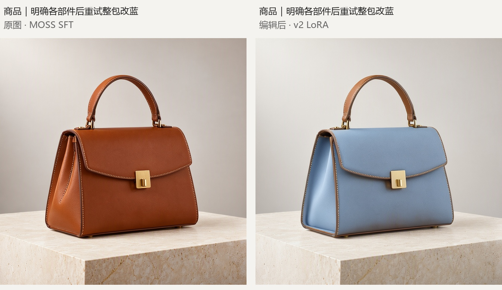

# ComfyUI ShenDuMao MOSS Edit

[中文](README.md) · [Example workflow](workflows/shendumao_moss_sft_v2_edit.json) · [Attribution](NOTICE.md)

Single-reference image-editing nodes for **MOSS Image** in ComfyUI. Load a reference image and the companion edit LoRA, then describe a specific local change such as adding eyeglasses or recoloring clothing or a product.

**Download the LoRA: MODEL_LINK_PENDING**

**Trained by ShenDuMao (神都猫) using AI-Toolkit, 2,000 steps, v2.** Examples use **MOSS Image SFT** for inference. This is an experimental release: other details may be redrawn and some instructions are only partly followed.

## Installation

1. Update ComfyUI to the latest version and update its dependencies according to the official instructions.
2. From `ComfyUI/custom_nodes`, run:

```bash
git clone https://github.com/signerzwb/ComfyUI-ShenDuMao-MOSS-Edit.git
```

3. Restart ComfyUI. No additional pip dependencies are required; the plugin uses ComfyUI's PyTorch, safetensors and native model loaders.
4. Import [the SFT + v2 workflow](workflows/shendumao_moss_sft_v2_edit.json), select your model files, and upload the reference in LoadImage.

## Required files

| Asset | Directory |
|---|---|
| MOSS Image SFT diffusion model | `ComfyUI/models/diffusion_models/` |
| Full Qwen3.5 text/vision encoder | `ComfyUI/models/text_encoders/` |
| FLUX.2 VAE | `ComfyUI/models/vae/` |
| `moss_wendingedit_lr5e-5_1024_v2_000002000.safetensors` | `ComfyUI/models/loras/` |

Sources: [Comfy-Org/MOSS-Image](https://huggingface.co/Comfy-Org/MOSS-Image) and [official MOSS Image SFT](https://huggingface.co/OpenMOSS-Team/MOSS-Image-SFT). The plugin repository contains code, workflows and examples; download the LoRA separately above.

Tested filenames: `moss_image_sft_int8_convrot.safetensors`, `qwen3.5_9b_w4a8_gptq.safetensors`, `flux2-vae.safetensors`. Choose the matching local files in each loader. The encoder must include its **complete vision weights**; text-only checkpoints are unsuitable for this editing workflow.

## Usage

1. Select SFT, the full vision encoder, VAE and v2 LoRA. Start with LoRA strength `1.0`.
2. Upload one reference and write the complete edit instruction. Match its aspect ratio; dimensions must be multiples of 16.
3. Start with **50 steps, CFG 3, Euler, shift 5, seed 42 and an empty negative prompt**.
4. Keep the supplied `MOSS Edit Sigmas` and `SamplerCustom`. Prepare already handles negative-branch layer-22 skipping internally; **do not add another SkipLayerGuidance node**.

Prompt format for this LoRA:

```text
editpicforpartV1, [edit instruction], Only modify the requested content, and try to keep the rest of the image unchanged as much as possible
```

Specify counts, locations, existing appearance, target appearance and what should remain. The node uses the instruction as entered: it does not translate it, expand it or insert the training prefix/suffix.

## Examples

References were generated locally with MOSS SFT. Results are direct SFT + v2 LoRA outputs, without retouching, masks, compositing or repair by another model. Original PNGs contain the actual workflows. These are selected illustrations, not a success-rate benchmark.

### Add gold-rimmed eyeglasses


The glasses were added while the subject, earrings, clothing and setting remained broadly consistent; facial and texture details were slightly redrawn. [Input](examples/01_portrait_glasses/before.png) · [Output](examples/01_portrait_glasses/after.png) · [Actual prompt](examples/01_portrait_glasses/prompt.txt)

### Recolor a leather handbag



Explicit part descriptions changed the flap, front and side panels from caramel brown to powder blue. The clasp and stitching were broadly preserved. **The handle remained brown, so the request to recolor every leather part was not fully completed.** [Input](examples/08_handbag_explicit_whole/before.png) · [Output](examples/08_handbag_explicit_whole/after.png) · [Actual prompt](examples/08_handbag_explicit_whole/prompt.txt)

## Implementation and sources

The implementation follows the MOSS edit inference/sampling contract in [Ostris AI-Toolkit](https://github.com/ostris/ai-toolkit) and adapts reference-image integration from [Ostris's MOSS edit nodes](https://github.com/ostris/ComfyUI-MOSS-Image-Ostris-Edit). It integrates with native ComfyUI interfaces and does not include training software.

- Independent visual-semantic and VAE-detail reference paths, with aspect ratio preserved.
- Isolated reference attention at timestep zero; generated tokens use reference conditioning.
- Sampling-run-scoped reference K/V caches, separated by conditioning branch and cleared on completion or exceptions.
- AI-Toolkit-aligned shifted/snapped 1000-step sigma grids, with negative-only layer-22 skipping.
- Full-vision and LoRA mapping validation, plus cloned ModelPatchers/wrappers without modifying ComfyUI core.

Tested with ComfyUI `0.42.0`, commit `8f04fd6ecf4a548937971e840af2a985529fab76`, and PyTorch `2.9.1+cu130`. Ten numerical/API checks and real SFT editing runs were completed. Pixel-identical reproduction of Base training previews or other frameworks is not claimed.

## Credits and licenses

- Plugin maintenance and companion LoRA training: **ShenDuMao / 神都猫**.
- LoRA: **trained with AI-Toolkit for 2,000 steps, v2**.
- Plugin code: [MIT](LICENSE), retaining upstream Ostris copyright and permission notices. Reference revisions are listed in [NOTICE.md](NOTICE.md).
- LoRA licensing is specified in its download repository. Base models, encoders and VAEs retain their respective licenses.
