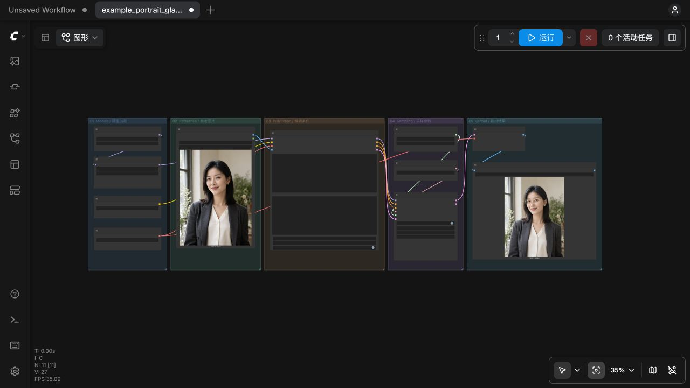

# 示例工作流 / Example workflows

| 工作流 / Workflow | 用途 / Purpose | 配套原图 / Reference |
|---|---|---|
| [shendumao_moss_sft_v2_edit.json](shendumao_moss_sft_v2_edit.json) | 通用 SFT + v2 单图编辑 / General edit | 自行上传 / Upload your own |
| [example_portrait_glasses.json](example_portrait_glasses.json) | 添加金框眼镜 / Add eyeglasses | [before.png](../examples/01_portrait_glasses/before.png) |
| [example_handbag_recolor.json](example_handbag_recolor.json) | 皮包改色 / Recolor a handbag | [before.png](../examples/08_handbag_explicit_whole/before.png) |

下载 JSON 后导入 ComfyUI，在 LoadImage 重新选择对应原图，并确认四个加载器中的模型文件正确。主模型为 SFT，LoRA 为神都猫 v2 2000 步。节点分为模型、原图、条件、采样、输出五区。

Import the JSON in ComfyUI, select the corresponding reference again in LoadImage, and confirm model filenames in the four loaders. Use MOSS SFT and ShenDuMao v2 2000-step LoRA. Five aligned groups organize models, reference, conditioning, sampling and output.

默认参数 / Defaults: 50 steps, CFG 3, Euler, shift 5, LoRA strength 1.0, seed 42. 保留原图比例，宽高为16的倍数。Preserve the reference aspect ratio and use dimensions divisible by 16.

[插件与完整教程 / Plugin and guide](https://github.com/signerzwb/ComfyUI-ShenDuMao-MOSS-Edit) · [LoRA 下载 / Download](https://www.modelscope.cn/models/shendumao/ShenDuMao-MOSS-Edit-LoRA-v2)

